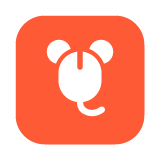

<p align="center">
  
</p>

<h1 align="center">Jon Mouse's</h1>

<p align="center">
  Une seule souris et un seul clavier pour tous les ordinateurs de ton bureau.<br>
  <a href="README.md">Read in English</a>
</p>

<p align="center">
  <a href="https://github.com/JANG-gitlab/jon-mouses/releases/latest/download/JonMouses-mac.dmg"><b>Télécharger pour Mac</b></a>
  &nbsp;·&nbsp;
  <a href="https://github.com/JANG-gitlab/jon-mouses/releases/latest/download/JonMouses-windows-setup.exe"><b>Télécharger pour Windows</b></a>
</p>

---

Tu pousses le curseur hors d'un écran et il passe sur le suivant, clavier compris, comme si ton Mac et ton PC ne formaient qu'un seul bureau. Tu copies sur l'un, tu colles sur l'autre.

## Pourquoi un de plus

Deskflow, Input Leap et Lan Mouse partagent déjà une souris. Jon Mouse's s'attaque à ce qu'ils laissent à l'utilisateur :

- **Rien à configurer.** Les appareils se trouvent seuls sur le réseau local. Pour les associer, on tape un code à 6 chiffres. Pas d'adresse IP, pas de serveur, pas de fichier de config.
- **Disposition à l'échelle réelle.** Chaque écran est dessiné à sa vraie taille en centimètres. On les place comme ils sont posés sur le bureau, et le curseur passe à la même hauteur physique, même entre un portable 13 pouces et un écran 27 pouces. Ailleurs, le bord fait mur.
- **Français et anglais** dès le départ.

## Installation

### Mac

1. Télécharge [`JonMouses-mac.dmg`](https://github.com/JANG-gitlab/jon-mouses/releases/latest/download/JonMouses-mac.dmg), ouvre-le et glisse Jon Mouse's dans Applications.
2. Ouvre-le une première fois. macOS dit qu'il ne peut pas vérifier le développeur : va dans **Réglages Système → Confidentialité et sécurité** et clique sur **Ouvrir quand même** en bas. Ça n'arrive que la première fois, parce que l'app n'est pas encore signée avec un compte développeur Apple payant.
3. La petite souris apparaît dans la barre des menus. Clique dessus et suis les deux lignes **Autoriser** (Accessibilité, puis Surveillance de l'entrée). macOS a besoin des deux pour lire et déplacer le curseur.

### Windows

1. Télécharge [`JonMouses-windows-setup.exe`](https://github.com/JANG-gitlab/jon-mouses/releases/latest/download/JonMouses-windows-setup.exe) et lance-le.
2. Si SmartScreen affiche une fenêtre bleue, clique sur **Informations complémentaires → Exécuter quand même**. Même raison : pas encore de certificat de signature payant.
3. Quand le pare-feu le demande, autorise les **réseaux privés**. La petite souris apparaît à côté de l'horloge.

## Utilisation

1. Lance Jon Mouse's sur les deux ordinateurs, sur le même réseau.
2. Dans le menu de l'un des deux, clique sur **Associer …**. L'autre affiche un code : tape-le.
3. Ouvre **Disposition des écrans…** et place les écrans comme ils sont vraiment. Le trait orange montre où le curseur peut passer.
4. Tiens **Ctrl + Alt + Échap** une seconde à tout moment pour ramener le curseur chez lui.

## Plateformes

| | Mac | Windows | Android | iPad | Linux |
|---|---|---|---|---|---|
| Souris et clavier partagés | ✅ | ✅ | prévu | ❌ | prévu |
| Disposition à l'échelle réelle | ✅ | ✅ | prévu | ❌ | prévu |
| Presse-papiers partagé (texte, images) | ✅ | ✅ | prévu | ❌ | prévu |
| Écran principal seulement | oui, pour l'instant | oui, pour l'instant | | | |

**L'iPad, ce ne sera pas possible** : iPadOS interdit à une app de déplacer le pointeur ou de taper dans les autres apps. Seul Universal Control d'Apple le peut.

## Le Wi-Fi sur Mac

Les Mac gardent une seconde liaison radio pour AirDrop et Continuité (AWDL). Environ une fois par seconde, elle fait passer la puce Wi-Fi sur un autre canal pendant 50 à 100 ms, et le curseur saccade. Un câble règle le problème, tout comme régler le canal 5 GHz de la box sur 44 ou 149.

Sinon, au premier lancement, Jon Mouse's propose d'installer un petit service qui coupe AWDL tant que l'app tourne et le rallume quand tu la quittes. macOS demande ton mot de passe une seule fois. Si tu as refusé, le menu garde une ligne **Réduire les saccades Wi-Fi…**. Le service tient en deux petits fichiers dans [`app/helper`](app/helper) ; pour l'installer à la main :

```bash
sudo install -o root -g wheel -m 755 app/helper/awdl.sh /Library/PrivilegedHelperTools/app.jonmouses.awdl
sudo install -o root -g wheel -m 644 app/helper/app.jonmouses.awdl.plist /Library/LaunchDaemons/app.jonmouses.awdl.plist
sudo launchctl bootstrap system /Library/LaunchDaemons/app.jonmouses.awdl.plist
```

Pour le retirer :

```bash
sudo launchctl bootout system/app.jonmouses.awdl
sudo rm /Library/LaunchDaemons/app.jonmouses.awdl.plist /Library/PrivilegedHelperTools/app.jonmouses.awdl
```

## Sécurité et vie privée

- L'association passe par SPAKE2 sur le code à 6 chiffres : quelqu'un qui écoute le réseau ne peut pas le deviner hors ligne, et un attaquant n'a qu'un essai par code.
- Chaque connexion utilise ensuite Noise IK avec les clés échangées à l'association. Les mouvements passent en UDP chiffré, tout le reste en TCP chiffré.
- Rien ne sort du réseau local. Pas de compte, pas de télémétrie.

## Compiler soi-même

Il faut Rust et Node.js.

```bash
cd app
npx @tauri-apps/cli@2 build
```

## Remerciements

La capture et la simulation des entrées s'appuient sur les crates `input-capture` et `input-emulation` de [Lan Mouse](https://github.com/feschber/lan-mouse) par Ferdinand Schober, corrigées dans [`vendor/`](vendor) pour une capture plus fluide sur macOS et une répétition de touches fiable.

## Licence

[GPL-3.0](LICENSE). Pour contribuer, voir [CONTRIBUTING.md](CONTRIBUTING.md).
